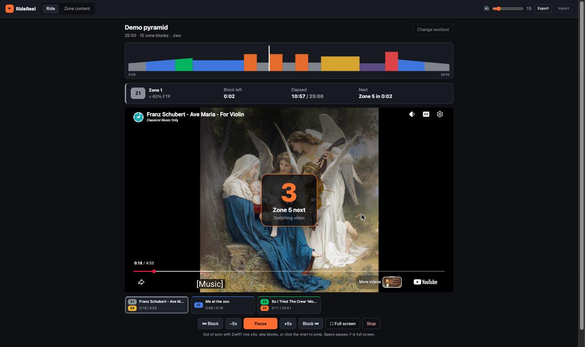
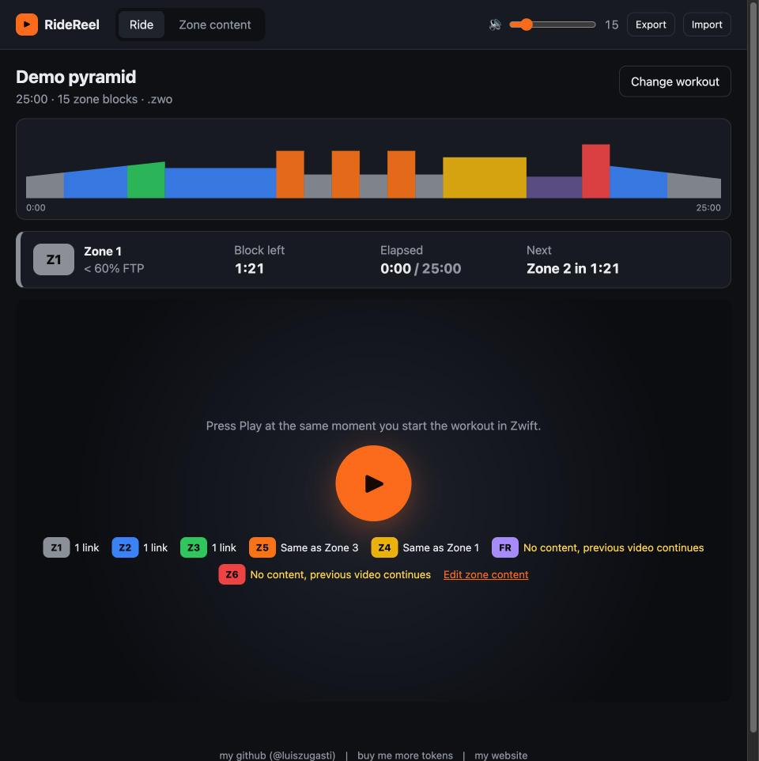
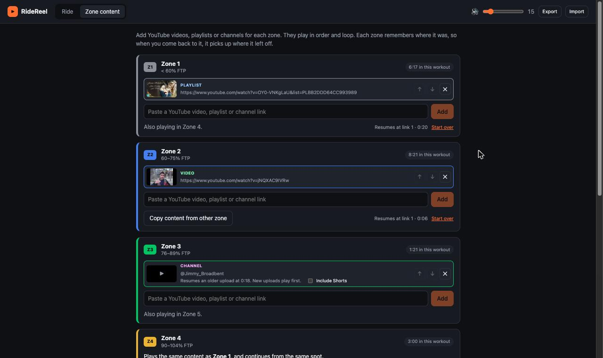
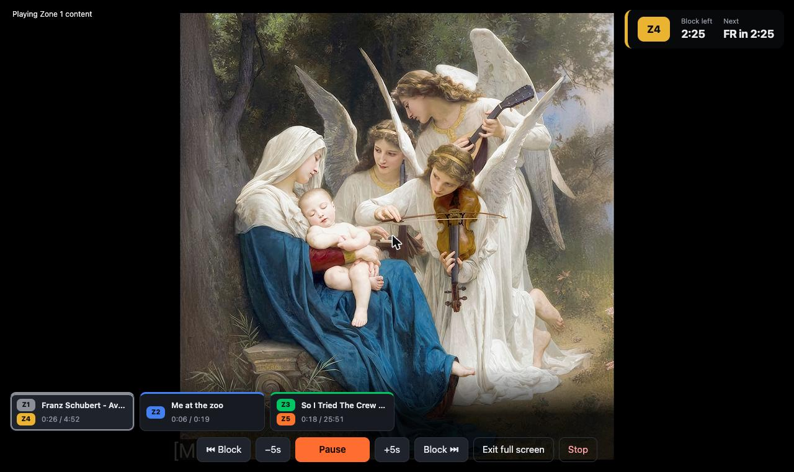

# RideReel

> [!WARNING]
> This whole project was **vibe-coded**. I haven't checked the code. Use it at your own risk.

Plays YouTube videos, playlists and channels that match the zone of your Zwift workout.



## Screenshots

| Load a workout and press Play with Zwift | Choose content for each zone |
| --- | --- |
|  |  |

**Full screen**, with the zone status in the corner and the content bar docked at the bottom:



## Run

Needs [Node.js](https://nodejs.org) 22 or newer. Then, in one line:

```sh
git clone https://github.com/luiszugasti/zwift-entertainment.git && cd zwift-entertainment && npm start
```

`npm start` installs dependencies, starts the app at http://localhost:5173 and opens it in your browser. Next time,
from the `zwift-entertainment` folder: `git pull && npm start`.

Settings (zone links, volume, FTP, where each zone left off) are saved in the browser, for that browser and
http://localhost:5173 only. They don't move between machines; use **Export** / **Import** to copy your zone setup.
The app always uses port 5173 and stops with "Port 5173 is already in use" rather than switching ports, because a
different port would start with empty settings.

**Mac Dock button:** run `scripts/install-mac-app.sh` once from the repo. It creates `~/Applications/RideReel.app`
(orange play icon) and adds it to the Dock. Clicking it starts the app if it isn't running and opens it in your
browser. The server keeps running in the background; its log is in `~/Library/Logs/RideReel.log`. If you move the
repo, run the script again. Use `--no-dock` to skip adding it to the Dock.

Other commands: `npm run dev` (start without installing or opening a browser), `npm test`, `npm run build`.
Open the app through the server, not as a local file: YouTube's player and the channel lookup need it.

## How it works

1. **Zone content**: add YouTube video or playlist links for Zone 1–6 and Free ride. Links play in order and loop.
   "Copy content from other zone" makes a zone play another zone's content and share its position.
2. **Ride**: load a `.zwo`, `.erg` or `.mrc` workout (or press **Just watch** to pick any zone's content with no
   workout). Press Play when you start the workout in Zwift.
3. 3 seconds before each zone change there is a countdown with beeps. At the change, the old video pauses and
   the new zone's content resumes where it left off.
   - Same content in both zones: countdown only, playback continues.
   - Zone with no content: the current video keeps playing.
4. The bar under the video has a button per zone with content, showing its current video and time. Pressing one
   switches the video to that content until the workout reaches a zone that has its own content (zones without
   content keep your pick).
5. When the workout ends, the video keeps playing and a 10-second "Keep watching?" prompt appears. Continue to keep
   watching (Pause and Finish stay available); otherwise the workout complete screen shows. The bar stays there too:
   pick a zone to keep watching after the ride.
6. Positions are saved in the browser between rides. Settings can be exported/imported as JSON.

## intervals.icu

**Today from intervals.icu** (on the load screen, and next to "Change workout") loads today's planned workout
from your intervals.icu calendar. If there's one ride planned it loads straight away; if there are several, you pick.

The first time, it asks for your API key: in intervals.icu, go to **Settings → Developer Settings** and copy the
**API Key**. It's stored in this browser only (not in exported settings); "Use a different API key" replaces it.
Requests go through the RideReel server (`npm start` or the Dock app), which only forwards two read-only calls:
the day's planned events, and a workout as `.zwo`.

## Channels

Paste a channel link (e.g. `https://www.youtube.com/@Jimmy_Broadbent`). The channel plays newest first and works back
through older uploads. When new uploads appear, they play first (newest down), and once the next video would be the
newest one you already knew about, playback returns to where you were in the older uploads (from the start of that
video). Shorts are skipped unless "Include Shorts" is ticked.

Limits:
- Looking up a channel handle needs the dev or preview server (`npm run dev` / `npm run preview`), because YouTube
  doesn't let browsers fetch channel pages. On a plain static host, paste a `youtube.com/channel/UC…` link instead.
- YouTube's player only exposes the newest 200 uploads. Older videos are reached by position, and more than ~200 new
  uploads between rides resets the "known" marker instead of catching up on all of them.
- An upcoming premiere or scheduled stream that won't start is skipped after 60 seconds.

Zones use Zwift's ranges: Z1 <60%, Z2 60–75%, Z3 76–89%, Z4 90–104%, Z5 105–118%, Z6 ≥119% of FTP.
Ramps switch zones at the point they cross a boundary. `.erg` files in watts without an FTP ask you for your FTP.

The app can't see Zwift, so it follows the workout file's clock. If it drifts, use ±5s (←/→), the block
skip buttons, or click the chart to jump. Space pauses.

Press F (or the Full screen button) to make the video area full screen. It keeps the countdown, the zone status
and the content bar, which fade out after 3 seconds without input. Hover the round button in the
bottom-right corner to bring them back (mouse movement over the video itself doesn't reach the app). YouTube's own full-screen button is turned
off, because it would only cover one player.

Sample workouts are in `samples/`; `quick-test.zwo` is 2 minutes of short blocks for checking switching.

## License

MIT, see [LICENSE](LICENSE).
